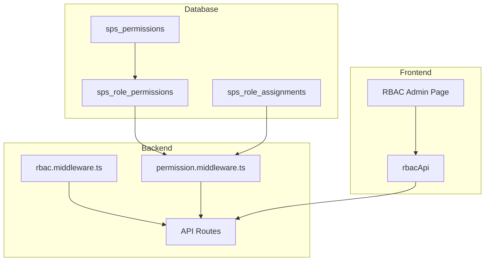

# SustainPro RBAC (Role-Based Access Control) Guide

This document explains how the role and permission system works in the SustainPro project, how to manage permissions, and how to protect API routes.

---

## Table of Contents

1. [Overview](#overview)
2. [System Architecture](#system-architecture)
3. [Database Schema](#database-schema)
4. [Available Roles](#available-roles)
5. [Available Permissions](#available-permissions)
6. [Managing Permissions via UI](#managing-permissions-via-ui)
7. [Managing Permissions via Database](#managing-permissions-via-database)
8. [Protecting Routes with Permissions](#protecting-routes-with-permissions)
9. [Adding New Permissions](#adding-new-permissions)
10. [Best Practices](#best-practices)

---

## Overview

SustainPro uses a **hybrid RBAC system** that supports:

1. **Role-Based Checks**: Check if a user has a specific role (e.g., `ORG_ADMIN`, `EVENT_MANAGER`)
2. **Permission-Based Checks**: Check if a user has specific granular permissions (e.g., `events:create`, `devices:view`)

The system uses a **role hierarchy** where higher roles can perform actions of lower roles, and **Super Admins** bypass all permission checks.

---

## System Architecture



**Key Files:**
| File | Purpose |
|------|---------|
| `packages/shared-database/prisma/schema.prisma` | Database schema (Prisma ORM) |
| `packages/shared-database/prisma/seed.ts` | Seed data script |
| `packages/shared-middleware/src/rbac.middleware.ts` | Role-based middleware |
| `packages/shared-middleware/src/permission.middleware.ts` | Permission-based middleware |
| `services/auth-service/src/routes/rbac.routes.ts` | RBAC API endpoints |
| `frontend/src/app/admin/rbac/page.tsx` | RBAC management UI |
| `frontend/src/lib/roles.ts` | Frontend role definitions |

> **Note:** This project uses **Prisma ORM** for database management. Run `npm run prisma:seed` from `packages/shared-database` to seed initial data.

---

## Database Schema (Prisma)

The database schema is defined in `packages/shared-database/prisma/schema.prisma`.

### Permissions Model (`sps_permissions`)

Stores all available permissions in the system:

```prisma
model sps_permissions {
  id                   String                 @id @default(dbgenerated("uuid_generate_v4()")) @db.Uuid
  name                 String                 @unique @db.VarChar(100)
  code                 String                 @unique @db.VarChar(50)  // e.g. 'events.view'
  description          String?
  category             String?                @db.VarChar(50)          // e.g. 'events'
  created_at           DateTime?              @default(now()) @db.Timestamptz(6)
  sps_role_permissions sps_role_permissions[]
}
```

### Role-Permission Mappings (`sps_role_permissions`)

Maps which permissions each role has:

```prisma
model sps_role_permissions {
  id              String          @id @default(dbgenerated("uuid_generate_v4()")) @db.Uuid
  role            String          @db.VarChar(50)   // e.g. 'ORG_ADMIN'
  permission_id   String          @db.Uuid
  created_at      DateTime?       @default(now()) @db.Timestamptz(6)
  sps_permissions sps_permissions @relation(fields: [permission_id], references: [id], onDelete: Cascade)

  @@unique([role, permission_id])
}
```

### Role Assignments (`sps_role_assignments`)

Assigns roles to users with optional scope (organization, event, department, service):

```prisma
model sps_role_assignments {
  id         String    @id @default(dbgenerated("uuid_generate_v4()")) @db.Uuid
  user_id    String    @db.Uuid
  role       String    @db.VarChar(50)   // e.g. 'ORG_ADMIN', 'EVENT_MANAGER'
  org_id     String?   @db.Uuid
  event_id   String?   @db.Uuid
  dept_id    String?   @db.Uuid
  service_id String?   @db.Uuid
  created_at DateTime? @default(now()) @db.Timestamptz(6)
  // ... relations
}
```

---

## Available Roles

The system has a **role hierarchy** (higher roles have more access):

| Role | Level | Description |
|------|-------|-------------|
| `SUPER_ADMIN` | 100 | Platform-wide admin (bypasses all checks) |
| `ORG_ADMIN` | 80 | Organization administrator |
| `EVENT_MANAGER` | 60 | Manages organization events |
| `DEPT_HEAD` | 40 | Department head |
| `SERVICE_SUPERVISOR` | 30 | Service supervisor |
| `TECHNICIAN` | 20 | Onsite technician |
| `VIEWER` | 10 | Read-only access |

> **Note:** `SUPER_ADMIN` is a virtual role based on the `is_super_admin` flag in the users table, not from role assignments.

---

## Available Permissions

Default permissions seeded in the database:

### Events Module
| Code | Name | Description |
|------|------|-------------|
| `events:view` | View Events | View list and details of events |
| `events:create` | Create Events | Create new events |
| `events:edit` | Edit Events | Modify event details |
| `events:delete` | Delete Events | Remove events permanently |
| `events:manage_manager` | Manage Event Manager | Assign managers to events |

### Users Module
| Code | Name | Description |
|------|------|-------------|
| `users:view` | View Users | View list and profiles of users |
| `users:create` | Create Users | Invite or create new users |
| `users:edit` | Edit Users | Modify user details and roles |
| `users:delete` | Delete Users | Remove users |

### Organization Module
| Code | Name | Description |
|------|------|-------------|
| `org:settings` | Manage Settings | Manage main organization settings |
| `reports:view` | View Reports | Access system reports and analytics |

### Devices Module
| Code | Name | Description |
|------|------|-------------|
| `devices:view` | View Devices | View device inventory |
| `devices:provision` | Provision Devices | Add and setup new devices |
| `devices:control` | Control Devices | Execute remote commands |

---

## Managing Permissions via UI

### Accessing the RBAC Page

1. Login as a **Super Admin** user
2. Navigate to `/admin/rbac`

### Changing Role Permissions

1. **Select a Role** from the left sidebar (e.g., "Organization Admin")
2. **Toggle Permissions** by clicking individual checkboxes
3. **Toggle Entire Modules** using the "Enable Module" checkbox
4. Click **"Save Changes"** to apply

> ⚠️ **Warning:** Changes affect all users with this role immediately after saving.

```
┌─────────────────────────────────────────────────────────────┐
│  Access Control (RBAC)                                      │
├───────────────────┬─────────────────────────────────────────┤
│                   │  Organization Admin                     │
│  Select Role      │  Managing 14 permissions         [Save] │
│  ─────────────    │  ─────────────────────────────────────  │
│  ☐ Org Admin      │  Events                    [✓] Enable   │
│  ○ Event Manager  │  ┌──────────────────────────────────┐  │
│  ○ Dept Head      │  │ [✓] View Events                  │  │
│  ○ Technician     │  │ [✓] Create Events                │  │
│  ○ Viewer         │  │ [✓] Edit Events                  │  │
│                   │  │ [✓] Delete Events                │  │
│                   │  └──────────────────────────────────┘  │
└───────────────────┴─────────────────────────────────────────┘
```

---

## Managing Permissions via Prisma Seed

All permission management is done through the Prisma seed file at `packages/shared-database/prisma/seed.ts`. This approach is type-safe and version-controlled.

### Adding a New Permission

Add to the `permissions` array in `seed.ts`:

```typescript
// In packages/shared-database/prisma/seed.ts

const permissions = [
    // Existing permissions...
    { name: 'View Dashboard', code: 'dashboard.view', description: 'View main dashboard', category: 'dashboard' },
    
    // ✅ Add new permissions here:
    { name: 'Export Reports', code: 'reports.export', description: 'Export reports to CSV/PDF', category: 'reports' },
    { name: 'View Billing', code: 'billing.view', description: 'View billing information', category: 'billing' },
    { name: 'Manage Billing', code: 'billing.manage', description: 'Update payment methods', category: 'billing' },
];

// The seed file automatically upserts permissions:
for (const perm of permissions) {
    await prisma.sps_permissions.upsert({
        where: { code: perm.code },
        update: {},
        create: perm,
    });
}
```

### Assigning Permission to a Role

Update the `rolePermissionMappings` object in `seed.ts`:

```typescript
// In packages/shared-database/prisma/seed.ts

const rolePermissionMappings: Record<string, string[]> = {
    'ORG_ADMIN': [
        'dashboard.view', 'devices.view', 'devices.manage', 'events.view', 'events.manage',
        'users.view', 'users.manage', 'reports.view', 'settings.manage', 'telemetry.view',
        'billing.view', 'billing.manage',  // Add new permissions here
    ],
    'EVENT_MANAGER': [
        'dashboard.view', 'events.view', 'events.manage', 'devices.view', 'reports.view',
    ],
    'VIEWER': [
        'dashboard.view', 'events.view', 'devices.view', 'reports.view',
        'billing.view',  // Viewers can only view, not manage
    ],
};
```

### Removing Permission from a Role

Simply remove the permission code from the role's array in `rolePermissionMappings` and re-run the seed.

### Re-run the Seed

After making changes, apply them to the database:

```bash
cd packages/shared-database
npm run prisma:seed
```

### View All Role-Permission Mappings (Prisma Studio)

Use Prisma Studio to visually browse the database:

```bash
cd packages/shared-database
npx prisma studio
```

### View Mappings via Code

```typescript
import { PrismaClient } from '@prisma/client';
const prisma = new PrismaClient();

// Get all role-permission mappings
const mappings = await prisma.sps_role_permissions.findMany({
    include: { sps_permissions: true },
    orderBy: { role: 'asc' },
});

// Group by role
const byRole = mappings.reduce((acc, m) => {
    if (!acc[m.role]) acc[m.role] = [];
    acc[m.role].push(m.sps_permissions.code);
    return acc;
}, {} as Record<string, string[]>);

console.log(byRole);
```

---

## Protecting Routes with Permissions

### Method 1: Role-Based Protection (Simple)

Use `requireRole()` middleware when you need to check for specific roles:

```typescript
import { requireRole } from '@sustainpro/shared-middleware';

// Only SUPER_ADMIN and ORG_ADMIN can access
router.post(
    '/devices',
    requireRole('SUPER_ADMIN', 'ORG_ADMIN'),
    deviceController.create
);

// Only SUPER_ADMIN can access
router.post(
    '/device-models',
    requireRole('SUPER_ADMIN'),
    deviceModelController.create
);
```

### Method 2: Minimum Role Level

Use `requireMinRole()` to check if user has at least a certain role level:

```typescript
import { requireMinRole } from '@sustainpro/shared-middleware';

// Anyone with EVENT_MANAGER or higher can access
router.get(
    '/events',
    requireMinRole('EVENT_MANAGER'),
    eventController.getAll
);
```

### Method 3: Permission-Based Protection (Granular)

Use `requirePermission()` for fine-grained permission checks:

```typescript
import { requirePermission } from '@sustainpro/shared-middleware';

// Only users with 'devices:provision' permission
router.post(
    '/devices',
    requirePermission('devices:provision'),
    deviceController.create
);
```

### Method 4: Multiple Permissions

```typescript
import { requireAnyPermission, requireAllPermissions } from '@sustainpro/shared-middleware';

// User needs ANY of these permissions
router.get(
    '/reports',
    requireAnyPermission('reports:view', 'reports:export'),
    reportController.getAll
);

// User needs ALL of these permissions
router.post(
    '/reports/export',
    requireAllPermissions('reports:view', 'reports:export'),
    reportController.export
);
```

### Method 5: Super Admin Only

```typescript
import { requireSuperAdmin } from '@sustainpro/shared-middleware';

// Only Super Admins
router.get('/admin/system-health', requireSuperAdmin, adminController.health);
```

### Method 6: Organization Access

```typescript
import { requireOrgAccess } from '@sustainpro/shared-middleware';

// User must belong to the organization (or be super admin)
router.get(
    '/organizations/:orgId/events',
    requireOrgAccess,
    eventController.getByOrg
);
```

---

## Adding New Permissions (Complete Workflow)

### Step 1: Add Permission to Seed File

Edit `packages/shared-database/prisma/seed.ts`:

```typescript
// Add to the permissions array
const permissions = [
    // ... existing permissions ...
    
    // New permissions
    { name: 'View Billing', code: 'billing.view', description: 'View billing information', category: 'billing' },
    { name: 'Manage Billing', code: 'billing.manage', description: 'Update payment methods', category: 'billing' },
];
```

### Step 2: Assign Permissions to Roles

In the same `seed.ts` file, update `rolePermissionMappings`:

```typescript
const rolePermissionMappings: Record<string, string[]> = {
    'ORG_ADMIN': [
        // ... existing permissions ...
        'billing.view', 'billing.manage',  // Full access
    ],
    'VIEWER': [
        // ... existing permissions ...
        'billing.view',  // Read-only access
    ],
};
```

### Step 3: Run the Seed

```bash
cd packages/shared-database
npm run prisma:seed
```

### Step 4: Protect Routes

```typescript
// In your routes file
import { requirePermission } from '@sustainpro/shared-middleware';

router.get('/billing', requirePermission('billing.view'), billingController.get);
router.put('/billing', requirePermission('billing.manage'), billingController.update);
```

### Step 5: (Optional) Frontend Permission Check

```typescript
// In frontend component
const { user } = useAuth();

const canManageBilling = user?.permissions?.includes('billing.manage');

return (
    <div>
        <BillingInfo />
        {canManageBilling && <EditBillingButton />}
    </div>
);
```

---

## Best Practices

### 1. Use Descriptive Permission Codes

```
✅ Good: 'events:create', 'users:delete', 'reports:export'
❌ Bad:  'perm1', 'create', 'do_stuff'
```

### 2. Group Permissions by Module

Organize permissions by feature area for easier management.

### 3. Use Permission Caching

The permission middleware caches user permissions for 5 minutes to reduce database queries. Call `clearPermissionCache(userId)` when roles change.

### 4. Super Admin Bypass

Super Admins automatically bypass all permission checks. Don't rely on permissions to restrict Super Admins.

### 5. Use Role Checks for Coarse Access

For simple "admin or not" checks, use `requireRole()`. For granular feature access, use `requirePermission()`.

### 6. Clear Cache After Role Changes

```typescript
import { clearPermissionCache } from '@sustainpro/shared-middleware';

// After updating a user's role
clearPermissionCache(userId);
```

---

## API Reference

### RBAC API Endpoints

| Method | Endpoint | Description | Access |
|--------|----------|-------------|--------|
| GET | `/api/v1/rbac/permissions` | List all permissions | Authenticated |
| GET | `/api/v1/rbac/mappings` | Get role-permission mappings | Super Admin |
| POST | `/api/v1/rbac/mappings` | Update role permissions | Super Admin |

### Update Role Permissions API

```bash
POST /api/v1/rbac/mappings
Authorization: Bearer <super_admin_token>
Content-Type: application/json

{
    "role": "EVENT_MANAGER",
    "permissions": [
        "events:view",
        "events:edit",
        "devices:view",
        "devices:control",
        "reports:view"
    ]
}
```

---

## Troubleshooting

### Permission Not Working?

1. **Check if user has the role assigned** in `sps_role_assignments`
2. **Check if role has the permission** in `sps_role_permissions`
3. **Clear permission cache** if roles were recently changed
4. **Verify middleware is applied** in the route file

### View User's Effective Permissions (Prisma)

```typescript
import { PrismaClient } from '@prisma/client';
const prisma = new PrismaClient();

const userId = 'your-user-id';

// Get user's roles
const roleAssignments = await prisma.sps_role_assignments.findMany({
    where: { user_id: userId },
});

const roles = roleAssignments.map(ra => ra.role);

// Get permissions for those roles
const permissions = await prisma.sps_role_permissions.findMany({
    where: { role: { in: roles } },
    include: { sps_permissions: true },
});

const permissionCodes = [...new Set(permissions.map(p => p.sps_permissions.code))];
console.log('User permissions:', permissionCodes);
```

### View via Prisma Studio

```bash
cd packages/shared-database
npx prisma studio
```

Navigate to `sps_role_assignments` → filter by user → see their roles → check `sps_role_permissions` for permissions.

---

## Summary

| Task | Method |
|------|--------|
| Check if user has specific role | `requireRole('ROLE_NAME')` |
| Check if user has minimum role level | `requireMinRole('ROLE_NAME')` |
| Check if user has specific permission | `requirePermission('module.action')` |
| Check if user has any of permissions | `requireAnyPermission('perm1', 'perm2')` |
| Check if user has all permissions | `requireAllPermissions('perm1', 'perm2')` |
| Super Admin only access | `requireSuperAdmin` |
| Organization-specific access | `requireOrgAccess` |
| Manage permissions via UI | `/admin/rbac` (Super Admin only) |
| Add new permission | Add to `permissions` array in `seed.ts` |
| Assign permission to role | Update `rolePermissionMappings` in `seed.ts` |
| Apply changes to database | Run `npm run prisma:seed` |
| Browse database visually | Run `npx prisma studio` |
